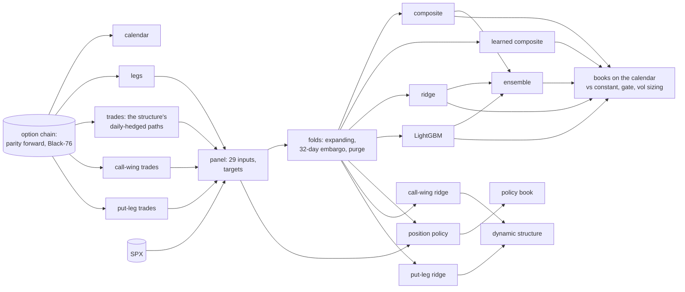

# mogul + chairlift: an ML Layer Around a VIX Vol-of-Vol Book

> [!NOTE]
> **This is the public showcase repository.** To request access to the private, full-source repository, please email [laurent.lanteigne@gmail.com](mailto:laurent.lanteigne@gmail.com).

[mogul](https://github.com/lanteignel93/mogul_trade_public) is a research book that sells VIX option premium every
trading day, delta-hedged, and keeps a vol-of-vol premium that travelled to a holdout nobody had read.
[chairlift](https://github.com/lanteignel93/chairlift_public) is the machine-learning research pipeline behind these
studies. This repository is what happened when the second was pointed at the first.

**The question:** using only what is known at entry, can a model size mogul's daily entries better than one unit each?

**The answer: no ML sizing is adopted.** Inside mogul's VIX gate, a ridge regression with stable, economically sensible
signs learns which entries will be stopped, and beats constant size by about half a Sharpe point. But the gain holds in
only 4 of 7 test years, the in-sample fit far exceeds the out-of-sample fit, and about 225 books were evaluated in the
search that found it. What chairlift added is mostly confirmation of what mogul had found by hand.

## The card (test years 2017–2023, daily-marked on every trading day, 1× costs)

| | constant size | ridge-sized | gain [99% CI] | test years better |
|---|---|---|---|---|
| the full structure, with the gate | 1.57 | 2.04 | +0.46 [−0.24, +1.16] | 4 of 7 |
| the call wing alone, with the gate | 1.72 | 2.36 | +0.64 [+0.15, +1.18] | 4 of 7 |
| the full structure, without the gate | 1.26 | 0.97 | −0.28 [−0.68, +0.49] | 3 of 7 |

The gain is a paired Sharpe difference on the same days, with a 21-day moving-block bootstrap (the same blocks for
both books). `ml_results.ipynb` reproduces every number here from the derived series in `data/`.

## The baseline

Every trading day at a fixed snapshot, sell 2 × the 15-delta call and 1 × the 15-delta put on the front monthly VIX
options, at 100 $ of vega. Hedge the delta daily in the VIX future of the same expiry. Hold to expiry, with a stop at
2.5 × the credit. mogul's gate makes no entry when the previous day's VIX close is below 15. The premium sits in the
call wing: tail hedgers buy VIX calls as crash insurance, and dealers charge for being short vol-of-vol.

## The model

- **Target:** each daily entry's final P&L in $ at 100 $ of vega. The full structure, and each leg alone.
- **Inputs (29, all known at entry):** the VIX complex at the previous close, the realized vol of VIX, the futures
  slope, the legs' implied vols and the smile, the credit, SPX returns, drawdown and realized vol, scheduled FOMC and
  CPI releases inside the hold, the weekday.
- **Fit:** ridge, LightGBM, two sign-constrained composites and their ensemble, refitted each year on an expanding
  window from 2015, with an embargo of 32 trading days (the longest an entry can live) and purging on exit dates. The
  2024+ data stayed sealed.
- **Use:** an entry's size is 2 × its prediction's percentile among every earlier prediction. The mean size stays near
  1, so a model can only win by timing.

**What it learned** (the gated call wing; every sign below holds in all seven folds):
- **Sizes up** after an SPX drawdown, when the call wing is rich against the at-the-money (the smile), and with more
  credit and more days to expiry.
- **Sizes down** after a quarter of volatile VIX, after a VIX rise over the past month, and when a CPI release falls
  inside the hold.
- **The VIX level is not a stable input once the gate is on.** Its sign changes across folds.

**What it predicts.** Out-of-sample entries sorted into fifths by their prediction (the gated call wing):

| prediction fifth | 1 (lowest) | 2 | 3 | 4 | 5 |
|---|---|---|---|---|---|
| stop rate | 24% | 22% | 10% | 4% | 2% |
| mean P&L per entry | −$41 | $466 | $1,751 | $1,733 | $1,717 |

Inside the gate, the model mostly sorts out the entries that get run over. Without the gate the fifths have no order:
the model learns the VIX level, which ranks P&L but sizes up into the entries that get stopped.

**Why it is not adopted.**
- **The fit is mostly noise.** The in-sample rank correlation is 0.6–0.8 in every fold. Out of sample it swings from
  −0.71 (2017) to +0.64 (2021) to −0.17 (2022).
- **The samples are tiny.** Entries overlap for about a month, so inside the gate a fold trains on 8 to 46 independent
  months.
- **The gain bunches in a few years.** The ridge trails constant size in 2017–2019 and gains in 2020, 2021 and 2023.

**The other framings tried:**

| framing | result |
|---|---|
| P&L per unit of credit as the target, tercile selection, a risk model with inverse sizing (no gate) | none beats constant; predicted risk equals predicted reward, because both are the vol level |
| a 7-input smile-shape feature set, gated call wing | ridge 2.45, LightGBM 2.70 (+0.98 [−0.05, +1.58]) |
| learning the position directly, w = E[y \| x] / E[y² \| x] | gated 1.77–1.93, ungated 0.71; not better than the rank-sized ridge |
| a dynamic structure (each leg sized by its own ridge) | 1.76 against 1.28 for the constant leg mix; all of the gain is the call wing (+0.48 [+0.22, +0.88]) |
| the put leg alone | weak however it is sized (0.17–0.58) |
| a search over the trade's own settings (72 cells) | finds the family (gate, call-heavy, a stop), not a cell: walk-forward selection 0.88 against 1.71 in hindsight, probability of backtest overfitting 0.65 |
| a search over the ridge penalty (12 cells, gated) | robust: walk-forward selection 1.99 against 2.50, probability of backtest overfitting 0.25 |

## The pipeline that produced it

Every box is a cached stage keyed by its spec, its code and its inputs:



**What the machinery did well:**
1. **No leakage path.** Folds come from entry and exit dates, with the embargo and purging. Each fold re-checks its
   embargo before it fits. The sealed rows do not exist for the study.
2. **Reproducibility.** A separate script calling the pipeline's own fit functions rebuilt the stored books to the third
   decimal.
3. **The searches judged themselves.** Walk-forward selection and the probability of backtest overfitting showed at
   once that picking the best trade setting is overfitting, while the ridge penalty is not.
4. **Cheap iteration.** Seventeen framings in one evening, each costing only its new stages.

**Where it fell short, for this kind of book:**
1. **No native book for overlapping, path-marked entries.** The sizing books are client stages.
2. **The fit stage throws the fitted model away.** Each fold's coefficients and importances are computed and dropped;
   this review recovered them with a side script.
3. **The ledger counts one headline per run, not every book.** It shows 32 headlined trials; the honest count is about
   225 books.
4. **The deflated Sharpe tests the wrong question here.** It asks whether the best book beats zero, which a real
   premium makes trivially true. The decision question is the gain over constant size, which the client measures with
   paired confidence intervals.
5. **Flat days.** Books built from live positions drop the days without one, which overstates any gated book. Every
   book here is marked on the full trading calendar.
6. **No power check for this shape.** One would have flagged that a few dozen independent months cannot support 29
   inputs.

## Verdict

| claim | what was found | holds? |
|---|---|---|
| Inputs known at entry predict the trade's P&L | Without the gate, the vol level ranks P&L, but sizing on it adds risk. Inside the gate, stable-sign models sort the stops | inside the gate only |
| A model sizes the gated book better than constant | +0.46, CI includes zero, 4 of 7 years | not established |
| A model sizes the gated call wing better than constant | +0.64 [+0.15, +1.18], 4 of 7 years, in-sample far above out-of-sample | promising, not robust |
| Learning the position directly beats predict-then-size | 1.77–1.93 gated, 0.71 without the gate | no |
| Positioning the structure leg by leg helps | through the call wing alone | yes, the same signal |
| A search over the trade's settings finds a better trade | it finds the family, not a cell | the family only |

**Recommendation:** keep mogul's economics (the gate, the call-heavy structure, the stop, smaller size in persistent
vol-of-vol). If one ML candidate is carried forward, register the gated call-wing ridge as a sizing overlay and judge it
once, on its gain over constant size, on data it has not seen.

## Private repository structure

```
mogul_ml_trade_private/
├── README.md                # this layer: the question, the answer, how to run it
├── BASELINE.md              # mogul's own card and what it learned
├── chairlift_client/
│   ├── study.py             # the client: sources, panel, models, sizing books, policy, dynamic structure
│   ├── experiments/         # 19 run and search configurations
│   ├── REVIEW.md            # the review of the model and of the pipeline
│   ├── review/              # fold-model export, review notebook, public notebook builder
│   └── tests/
├── engine.py                # mogul's engine (the client imports it; there is no second engine)
├── PROTOCOL.md RESEARCH_PLAN.md HYPOTHESIS.md FINDINGS.md   # mogul's reviewed research
├── log/events.jsonl         # the append-only event log, the ML step included
├── scripts/ notebooks/ tests/
└── ...
```

*Nothing here is investment advice. `ml_results.ipynb` reproduces every figure from the small derived series in
`data/`: daily book P&L, per-entry predictions and outcomes, and the fitted models' coefficients. No market data is
included.*
